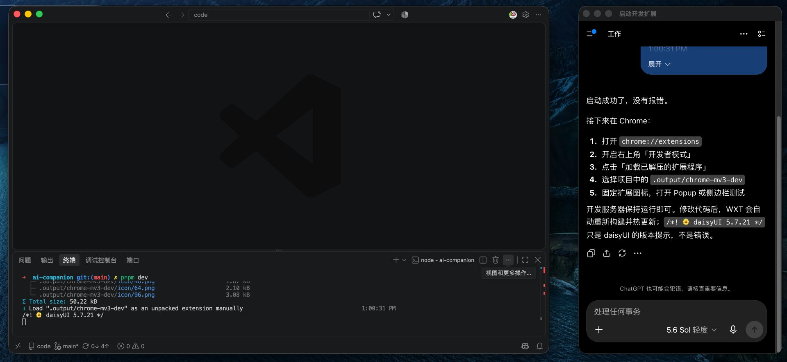
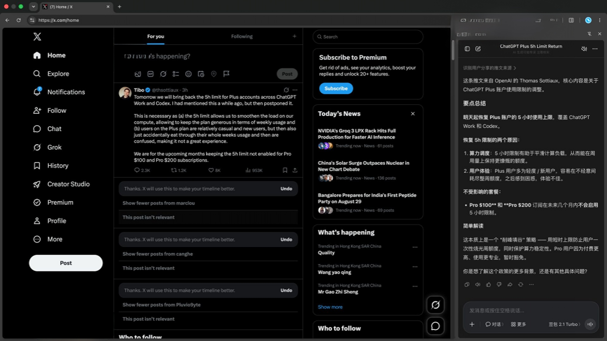

# AI Companion


[简体中文](./README.md) | [English](./README.en.md)

Keep the AI you already use next to your current work.

AI Companion is a Chrome extension that reuses native websites and their existing login sessions. It keeps AI close while you browse, write, or research without rebuilding a chat client or requiring an API key.

## Installation

### Microsoft Edge (recommended)

Once the Edge Add-ons listing is available, install it from the store to receive automatic updates. While the listing is under review, use the manual Chrome installation below.

### Manual installation in Chrome

Chrome does not support normal off-store installation on Windows or macOS, so the GitHub build must be loaded in developer mode:

1. Download the latest `ai-companion-*-chrome.zip` from GitHub Releases.
2. Extract it to a permanent folder. Do not move or delete the folder after installation.
3. Open `chrome://extensions`.
4. Enable **Developer mode**.
5. Click **Load unpacked** and select the extracted directory that contains `manifest.json`.
6. Pin AI Companion from the browser's extensions menu.

The ZIP cannot be dragged directly into Chrome. Manually installed builds do not update automatically. For a new version, download it, replace the previous files, and click **Reload** on the extension card at `chrome://extensions`.

## Features

### Separate window

Open the current HTTP(S) page in a separate Chrome popup window from the extension popup.



- Uses the complete native website instead of an iframe.
- Shares login sessions and cookies with Chrome.
- Focuses an existing window when the same page is already open.
- The window can be moved and resized, but a Chrome extension cannot guarantee that it stays always on top.

### Doubao side panel



Open Doubao in Chrome's Side Panel so that the AI website and the page you are browsing can remain side by side.

- Does not create another desktop window.
- Retains the conversations and account features provided by the Doubao website.
- Reduces the horizontal space available to the current page.
- Availability depends on Doubao's iframe, cookie, authentication, and security policies.

### Browser-language matching

The extension name, toolbar label, popup, and side panel automatically follow the browser language:

- Simplified Chinese: “AI 伴侣”.
- All other languages currently fall back to “AI Companion” in English.

There is no in-extension language selector. After changing the browser language, reload the extension or restart the browser.

## Usage

1. Click the AI Companion icon in the Chrome toolbar.
2. Choose **Popup window** to open the current page in a separate window, or choose **Side panel** to open Doubao beside the current page.
3. Continue using the original website's login, conversation history, and other features.

The separate-window action only supports regular `http://` and `https://` pages. Internal browser pages, including Chrome settings and extension pages, cannot be opened through this action.

## Privacy and security

- The extension does not read, scrape, or analyze the current page by default.
- You explicitly provide context to an AI using copy and paste, screenshots, files, or links.
- It does not bypass third-party CSP, `X-Frame-Options`, cookies, authentication, or other browser security policies.
- Future security-policy changes made by a third-party website may affect side-panel availability.

See the [Privacy Policy](./PRIVACY.md) for details. Report vulnerabilities according to the [Security Policy](./SECURITY.md).

### Why these permissions are needed

- `activeTab`: reads the active tab URL only after you click the popup-window action, so the same website can be opened in a separate window. It does not continuously read page content.
- `sidePanel`: displays the extension page and Doubao website in Chrome's Side Panel.

## Local development

The project uses [WXT](https://wxt.dev/), React 19, TypeScript, and Tailwind CSS v4. It requires Node.js 22 or newer and pnpm:

```sh
pnpm install
pnpm dev
pnpm check-types
pnpm build
pnpm zip
```

Development output:

`.output/chrome-mv3-dev`

Production output:

`.output/chrome-mv3`

A successful build is not real-browser compatibility validation. Before release, reload the exact generated directory in Chrome and verify Doubao loading, authentication, conversations, paste, and file-upload flows.

## Product boundaries

Document Picture-in-Picture is no longer part of the current product scope. Moving complex third-party pages proved unreliable across layout, input, dialogs, uploads, and page lifecycle behavior.

## Contributing

Issues and pull requests are welcome. Before submitting changes, run `pnpm check-types` and `pnpm build`, then reload `.output/chrome-mv3` in a real Chrome browser and exercise the affected user path.

This project is licensed under the [MIT License](./LICENSE).
