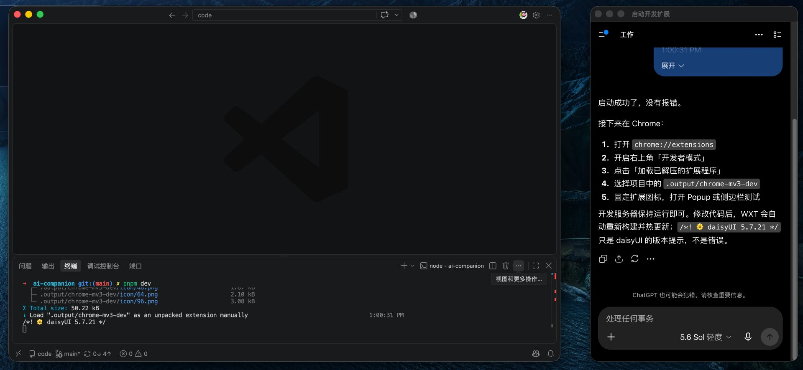

# AI 伴侣


[简体中文](./README.md) | [English](./README.en.md)

把你已经在使用的 AI，放到当前工作旁边。

AI 伴侣是一款 Chrome 扩展。它复用原生网页和现有登录状态，让你在浏览、写作或查资料时更方便地调用 AI，而不需要重新实现聊天客户端或配置 API Key。

## 安装

### Microsoft Edge（推荐）

Edge Add-ons 商店版本发布后，可直接从商店安装并自动接收更新。商店审核期间，可以先按下面的 Chrome 手动安装方式体验。

### Chrome 手动安装

Chrome 在 Windows 和 macOS 上不支持普通用户直接安装商店外扩展，因此 GitHub 版本需要通过开发者模式加载：

1. 在 GitHub Releases 下载最新的 `ai-companion-*-chrome.zip`。
2. 将 ZIP 解压到一个长期保留的文件夹；安装后不要移动或删除它。
3. 在地址栏打开 `chrome://extensions`。
4. 开启右上角的“开发者模式”。
5. 点击“加载已解压的扩展程序”，选择刚才解压后、包含 `manifest.json` 的目录。
6. 从浏览器扩展菜单中固定“AI 伴侣”。

ZIP 不能直接拖入 Chrome 安装。手动安装版本也不会自动更新；新版本发布后，需要重新下载并覆盖原目录，然后在 `chrome://extensions` 点击扩展卡片上的“重新加载”。

## 功能

### 独立小窗

从扩展弹窗中把当前 HTTP(S) 网页打开为独立 Chrome 小窗。



- 使用完整的原生网页，而不是 iframe。
- 与 Chrome 共享登录状态和 Cookie。
- 如果同一网页的小窗已经存在，再次打开时会聚焦现有窗口。
- 小窗可以移动和调整尺寸，但 Chrome 扩展无法保证它始终置顶。

### 豆包侧边栏

在当前 Chrome 窗口右侧的 Side Panel 中打开豆包，使 AI 与正在浏览的网页并排显示。

- 无需额外的桌面窗口。
- 保留豆包网页自身提供的对话和账号能力。
- 会占用浏览器的横向空间。
- 可用性取决于豆包的 iframe、Cookie、登录和安全策略。

### 跟随浏览器语言

扩展名称、工具栏提示、弹窗和侧边栏会自动匹配浏览器语言：

- 简体中文：显示“AI 伴侣”。
- 其他语言：默认使用英文 “AI Companion”。

当前不提供扩展内语言切换。修改浏览器语言后，需要重新加载扩展或重启浏览器。

## 使用方式

1. 在 Chrome 工具栏点击 AI 伴侣图标。
2. 选择“独立小窗”，把当前网页放进单独窗口；或选择“侧边栏”，在当前窗口右侧打开豆包。
3. 使用原网站已有的登录、历史对话和其他功能。

独立小窗只支持普通的 `http://` 和 `https://` 页面。Chrome 设置页、扩展页等浏览器内部页面不能通过该入口打开。

## 隐私与安全

- 扩展默认不读取、抓取或分析当前网页内容。
- 用户自行通过复制、粘贴、截图、文件或链接向 AI 提供上下文。
- 不绕过第三方网站的 CSP、`X-Frame-Options`、Cookie、认证或其他浏览器安全策略。
- 第三方网站后续调整安全策略时，侧边栏功能可能受到影响。

详细说明见[隐私政策](./PRIVACY.md)。安全问题请按[安全政策](./SECURITY.md)中的方式报告。

### 权限说明

- `activeTab`：仅在用户点击“独立小窗”时获取当前标签页的 URL，用于打开对应网页；不会持续读取页面内容。
- `sidePanel`：用于在 Chrome 侧边栏中显示扩展页面和豆包网页。

## 本地开发

项目使用 [WXT](https://wxt.dev/)、React 19、TypeScript 和 Tailwind CSS v4。需要 Node.js 22 或更高版本，并使用 pnpm：

```sh
pnpm install
pnpm dev
pnpm check-types
pnpm build
pnpm zip
```

开发产物位于：

`.output/chrome-mv3-dev`

正式构建位于：

`.output/chrome-mv3`

构建成功不等于真实浏览器兼容性验证。发布前仍需在 Chrome 中重新加载准确的生成目录，并验证豆包的加载、登录、对话、粘贴和上传流程。

## 产品边界

Document Picture-in-Picture 已退出当前产品范围，因为迁移复杂第三方网页时，布局、输入、弹窗、上传和页面生命周期不够稳定。

## 参与贡献

欢迎提交 Issue 和 Pull Request。提交改动前请运行 `pnpm check-types` 和 `pnpm build`，并在真实 Chrome 中重新加载 `.output/chrome-mv3` 验证相关用户路径。

本项目采用 [MIT License](./LICENSE) 开源。
